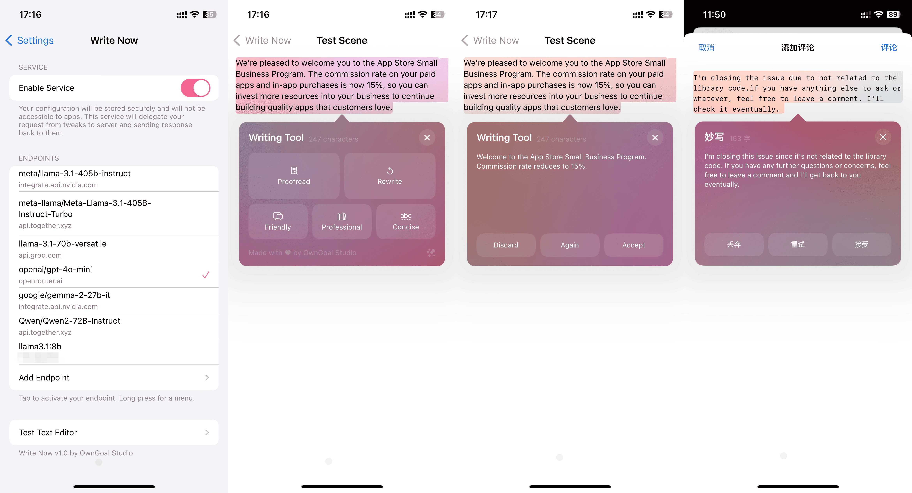

# 清稿 · Faircopy

**多种语言，轻松表达。**

清稿是一款适用于 iOS 的 AI 写作助手。通过文本编辑菜单，即可完成校对、重写和语气调整，并自由选择兼容 OpenAI API 的服务商或自部署服务器。

[English](../../../README.md)



## 目录

- [体验版](#体验版)
- [主要功能](#主要功能)
- [用户指南](#用户指南)
- [兼容性](#兼容性)
- [从源码构建](#从源码构建)
- [致谢](#致谢)
- [许可证](#许可证)

## 体验版

Faircopy Lite 将写作助手打包为独立应用，可配合 [TrollFools](https://github.com/Lessica/TrollFools/) 或类似注入工具，将写作功能带入其他应用。

请参照下方的[构建说明](#从源码构建)生成 `.tipa` 安装包，并在使用前配置自己的端点和模型。

## 主要功能

- **校对** — 修正拼写、语法和标点问题，保留原意。
- **重写** — 调整措辞与行文，让表达更加清晰、流畅。
- **友好语气** — 让消息和日常文字更加亲切、自然。
- **专业语气** — 润色正式、商务或学术场景中的表达。
- **简洁模式** — 去除冗余词句，保留核心信息。
- **自定义推理服务器配置** — 接入兼容 OpenAI API 的服务商或自部署服务器，自由选择模型。

不同模型的语言能力有所差异。处理中文时，请选择适合中文写作的模型。

## 用户指南

### 安装

在兼容的越狱设备上，使用 Sileo 等包管理器安装对应环境的 `.deb` 软件包。项目提供 rootless 和 RootHide 构建配置，详见[从源码构建](#从源码构建)。

独立应用的使用方式请参阅[体验版](#体验版)。

### 设置端点

打开清稿的偏好设置或配套应用，添加端点地址和 API 密钥，然后选择模型。你可以配置多个端点，并在写作工具界面切换模型。

提交的文本会发送到你配置的服务器进行处理。请根据自己的需求选择服务商的数据政策，或使用自部署服务器。

#### OpenAI API 提供商

以下是可填写到清稿中的端点示例。请向服务商获取 API 密钥，并选择账户可用的模型。

| 提供商 | 端点 | API 密钥 |
| --- | --- | --- |
| [OpenAI](https://platform.openai.com/) | `https://api.openai.com` | [管理密钥](https://platform.openai.com/api-keys) |
| [Together AI](https://www.together.ai/) | `https://api.together.xyz` | [管理密钥](https://api.together.ai/settings/api-keys) |
| [OpenRouter](https://openrouter.ai/) | `https://openrouter.ai/api` | [管理密钥](https://openrouter.ai/settings/keys) |
| [Groq](https://groq.com/) | `https://api.groq.com/openai` | [管理密钥](https://console.groq.com/keys) |
| [NVIDIA NIM](https://build.nvidia.com/) | `https://integrate.api.nvidia.com` | [开发者平台](https://build.nvidia.com/) |

清稿会自动添加 `/v1` API 路径，请按表格填写基础地址。模型可用性与使用额度由各服务商决定。

旧版指南中的 GitHub Models 端点已不可用，详见 [GitHub 服务说明](https://docs.github.com/en/github-models)。

#### 自托管 AI 服务器

你也可以接入通过 [Ollama](https://ollama.com/) 或 [Xinference](https://github.com/xorbitsai/inference) 部署的 OpenAI 兼容服务器。请填写 iOS 设备能够访问的地址，按需配置身份验证，并选择该端点提供的模型。

## 兼容性

- **iOS：** 15.0 及以上。
- **插件：** 需要兼容的越狱环境，提供 rootless 和 RootHide 软件包配置。
- **体验版：** 需要兼容的 TrollStore 环境；在其他应用中使用时，需要配合 TrollFools 或类似注入工具。
- **文本编辑：** 支持 UIKit 文本框和文本视图，并提供 WebKit 集成。具体可用性取决于应用的文本编辑实现。

## 从源码构建

### 环境要求

- macOS、Xcode 及 iOS SDK。
- 安装在 `~/theos` 的 [Theos](https://github.com/owngoal-dev/theos)，并配置好 SDK 和构建依赖。
- `PATH` 中可用的 [`swift-create-xcframework@5.9`](https://github.com/Lessica/swift-create-xcframework/releases/tag/v5.9)、`xcbeautify` 和 `ldid`。
- 打包体验版还需要 `insert_dylib` 和 `7z`。

解析 Swift 依赖时，请保留仓库中的 `Package.resolved` 锁定文件。

### Rootless 软件包

```sh
git clone https://github.com/owngoal-dev/WriteNow.git
cd WriteNow
source devkit/rootless.sh
FINALPACKAGE=1 make package
```

生成的 `.deb` 文件位于 `packages/` 目录。

### RootHide 软件包

使用 RootHide 工具链的 `legacy-roothide` 标签：

```sh
git clone --recursive --branch legacy-roothide https://github.com/owngoal-dev/theos-roothide.git ~/theos-roothide-legacy
```

配置好该工具链的 SDK 后，在清稿仓库目录执行：

```sh
source devkit/roothide.sh
FINALPACKAGE=1 make package
```

### 体验版安装包

```sh
source devkit/rootless.sh
./devkit/compile.sh
```

生成的 `FaircopyLite_*.tipa` 文件位于 `packages/` 目录，可通过 TrollStore 安装。

## 致谢

清稿基于以下开源项目构建：

- [OpenAI for Swift](https://github.com/MacPaw/OpenAI) — OpenAI 兼容 API 客户端。
- [SwiftNIO](https://github.com/apple/swift-nio) 与 [NIOSSL](https://github.com/apple/swift-nio-ssl) — 网络通信与 TLS。
- [ColorfulX](https://github.com/Lakr233/ColorfulX)、[ColorVector](https://github.com/Lakr233/ColorVector)、[SpringInterpolation](https://github.com/Lakr233/SpringInterpolation) 与 [MSDisplayLink](https://github.com/Lakr233/MSDisplayLink) — 色彩与动画。
- [SwiftUI Introspect](https://github.com/siteline/swiftui-introspect) — 访问底层 UIKit 视图。
- [libroot](https://github.com/opa334/libroot) — 越狱路径支持。

第三方依赖的许可证详见[第三方声明](../../../THIRD_PARTY_NOTICES.md)。

## 许可证

清稿基于 [MIT 许可证](../../../LICENSE) 开源。

---

**乌龙工作室倾情献制**
